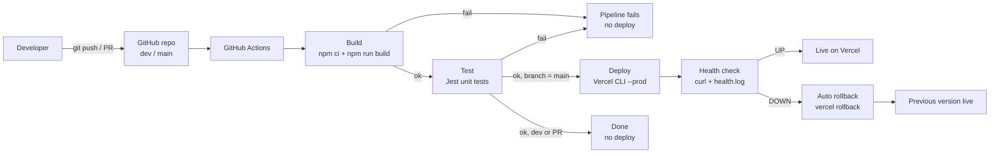
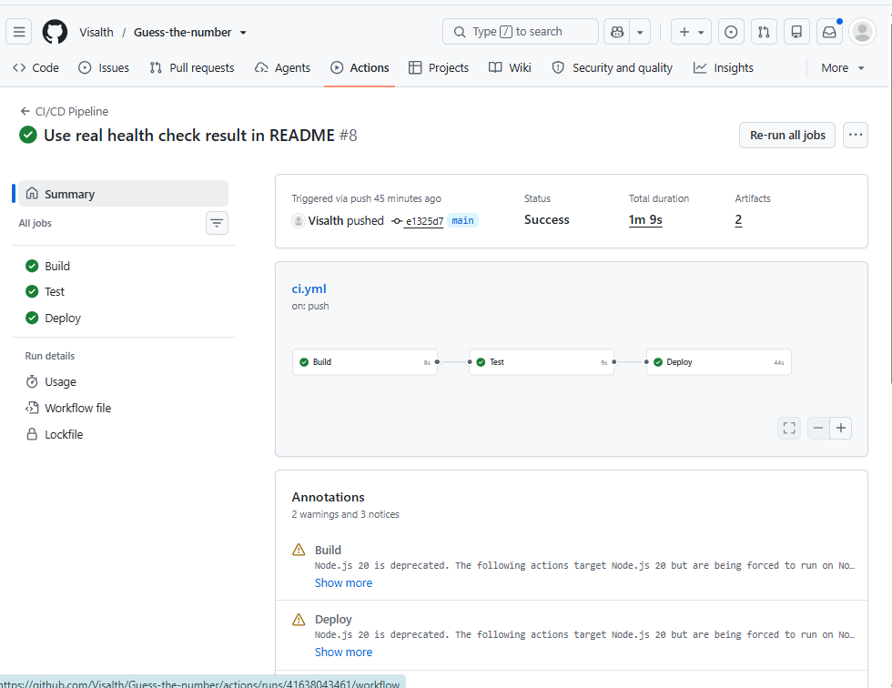
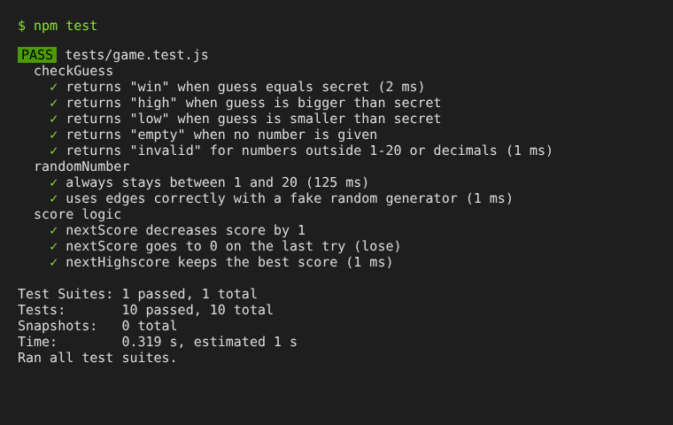
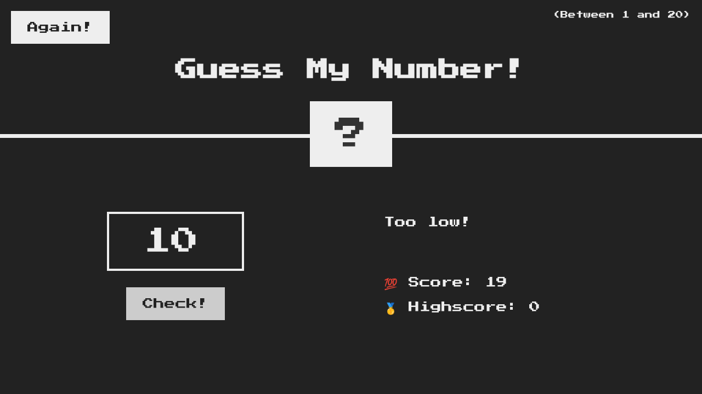

# Guess the Number - DevOps Pipeline

A retro-style **Guess the Number** browser game, used as the base for a DevOps midterm project.
The project shows version control, automated build, unit testing, CI/CD with GitHub Actions,
automatic deployment to Vercel, and monitoring with a health check and automatic rollback.

**Live app (Vercel):** https://guess-the-number-omega-seven.vercel.app

## 1. Project description

**What it does:** The game picks a secret number between 1 and 20. The player guesses it.
After each guess the game says "Too high!" or "Too low!", and the score goes down by 1.
At score 0 the player loses. The best score is kept as the highscore.

**Tools used**

| Area | Tool |
|------|------|
| App | HTML, CSS, JavaScript (DOM) |
| Unit tests | Jest |
| Version control | Git, GitHub (`main` and `dev` branches) |
| CI/CD | GitHub Actions |
| Deployment | Vercel (Vercel CLI in the pipeline) |
| Monitoring | Bash + curl health check, `health.log`, HTML status dashboard |

**Project structure**

```
.
├── index.html              # Game page
├── style.css               # Retro styles
├── game.js                 # Pure game logic (testable, no DOM)
├── script.js               # UI: connects game.js to the page
├── tests/game.test.js      # Jest unit tests
├── scripts/
│   ├── build.sh            # Build: copies the site into dist/
│   ├── healthcheck.sh      # Monitoring: curl check, writes health.log
│   └── dashboard.sh        # Bonus: builds status.html from health.log
├── vercel.json             # Vercel build settings
└── .github/workflows/ci.yml  # CI/CD pipeline
```

The game logic was moved out of `script.js` into `game.js` (functions `checkGuess`, `randomNumber`,
`nextScore`, `nextHighscore`). These are pure functions, so they can be tested without a browser.

## 2. CI/CD process

The pipeline is in `.github/workflows/ci.yml`. It runs automatically on **every push and every pull
request** to `main` and `dev`. It has 3 stages, and each stage runs only if the previous one passed.

| Stage | What it does |
|-------|--------------|
| **Build** | Checks out the code, sets up Node.js 22, installs dependencies with `npm ci`, runs `npm run build` (creates `dist/`), and saves `dist/` as an artifact. |
| **Test** | Installs dependencies and runs the Jest unit tests with `npm test`. If any test fails, the pipeline stops and nothing is deployed. |
| **Deploy** | Runs only on push to `main`. Uses the Vercel CLI to build and deploy to production, then runs the health check. If the health check fails, it runs `vercel rollback` to go back to the previous working version. The `health.log` and `status.html` are uploaded as artifacts. |

**Branch flow:** work is done on `dev`. Pushes to `dev` run Build and Test only. When `dev` is merged
into `main`, the full pipeline runs, including Deploy.

**Secrets used (GitHub > Settings > Secrets and variables > Actions):**
`VERCEL_TOKEN`, `VERCEL_ORG_ID`, `VERCEL_PROJECT_ID`. Optional variable `APP_URL` (the public
production URL used by the health check).

## 3. Workflow diagram



## 4. Monitoring and health check

`scripts/healthcheck.sh` checks if the deployed app is up:

- Sends a request with `curl` to the URL.
- The app is **UP** only if the HTTP code is 200 **and** the page contains "Guess My Number".
- Retries 3 times, 5 seconds apart.
- Writes every result with a timestamp to `health.log`.
- Exit code 0 = UP, 1 = DOWN (the pipeline uses this to decide on rollback).

Run it yourself:

```bash
bash scripts/healthcheck.sh https://guess-the-number-omega-seven.vercel.app health.log
```

Example `health.log`:

```
2026-11-03 12:19:49 UTC | UP   | https://guess-the-number-omega-seven.vercel.app | HTTP 200 | 0.010304s | attempt 1/3
```

**Bonus:**
- **Status dashboard:** `scripts/dashboard.sh` turns `health.log` into `status.html` (current status, uptime %, last 20 checks).
- **Automatic rollback:** if the health check fails after deploy, the pipeline runs `vercel rollback`.

## 5. Screenshots

**Successful 3-stage GitHub Actions pipeline (Build, Test, Deploy)**



**Unit tests passing (10 Jest tests)**



**Running app**



## 6. Run locally

```bash
npm ci
npm test
npm run build
```

Then open `dist/index.html` in a browser.
